# Power Smash Owner Guide

For the owner, on a phone. Plain English. Nothing in this guide needs you to write code.

**How to read the tags.** Every task says whether it works today. **LIVE** means it works for visitors now. **NOT LIVE YET** means the screen or the step is built (or planned) but is not connected to the real database, the real YouTube key, the real domain or the real publish step, so you cannot use it for real today. **Today nothing is public**: the site has not been published (the publish step is a stub, D-065, and owner inputs are still missing, OT-02, OT-19 to OT-22, OT-41). Everything below that touches real customers, real videos or real money is therefore marked NOT LIVE YET until the step it waits for is done.

The pictures in this guide are phone-size screenshots of the site built on **made-up data** (names like "Demo", "Sample", "Mock"). They are made by `scripts/guide-shots.mjs`. No real player, number or enquiry appears in them.

---

## What the site is

Power Smash is your YouTube badminton channel (@PowerSmash) plus a website with three parts (spec section 0):

1. **The Archive.** Pages built from your YouTube videos: matches, players and tournaments, so a fan can search "Karthik semi final" and find your video. Players under 18, and players whose age we do not know, are protected: no profile, no photo, no bio (D-012, D-078). Every page shows the YouTube title exactly as you typed it, and says the match details are "by Power Smash" (D-016).
2. **The Storefront.** Pages that sell what you offer: tournament coverage, sponsor packages, enquiry forms that send you a Telegram alert. Prices are only what you type in; the site never invents one (D-058).
3. **The Hub.** WhatsApp, Telegram alerts and, later, email alerts.

## What exists today and what is switched off

| Piece | State today | What it waits for |
|---|---|---|
| Money pages (services, pricing, book, partner, contact, about) | Built. Not public. | Your legal name, address, phone, email (OT-19), prices (OT-20), refund rules (OT-21), lawyer review (OT-15), Vercel account and project (OT-02; the Pro plan, USD 20 a month, before launch) |
| Enquiry forms (book, contact, partner, tournament submit, send your video, alerts, profile and removal request) | Built, tested on made-up data. **NOT LIVE YET** | Production Supabase (OT-27), spam check keys (OT-41), Telegram bot (OT-08) |
| Telegram alerts | Built. **NOT LIVE YET** | OT-08, OT-27 |
| Admin console | Built on made-up data ("Preview with made-up data" banner). **NOT LIVE YET** | Real sign-in (OT-51), production Supabase (OT-27), `REBUILD_DISPATCH_TOKEN` (OT-42) |
| Archive pages (matches, players) | Built on made-up data with a "Sample data" banner. **NOT LIVE YET** | YouTube key (OT-04), YouTube's answer (OT-16), lawyer answer on children's data (OT-28), your approval of the protected-player rules |
| Tournament pages | Not built yet (D-092 posters exist; the pages themselves do not) | Later slice |
| Automatic sync of your videos | Built, **switched off** (`SYNC_ENABLED`) | OT-03, OT-04, OT-16, OT-48 |
| Timer for new-upload detection (a scheduled call on Vercel) | Built, **parked** (`CRON_ENABLED`); needs Vercel Pro for anything more often than once a day (D-085, D-097) | Same as sync, plus your yes |
| QR posters | Built (A4 and A3). Do not print yet: the QR points to a local address until the real site address is set (D-092) | Real site address |
| Weekly backup | Built, **switched off** (`BACKUP_ENABLED`) | OT-27, OT-31, OT-43 |
| Uptime monitor | Not chosen yet (D-039, D-067) | OT-44 |
| Email (customer thank-you, owner email, alerts email) | Built, **switched off** (`EMAIL_ENABLED`) | Verified domain (OT-07), Resend (OT-40) |
| Razorpay payments inside the site | Phase 2, not built. Phase 1 uses Payment Links from the Razorpay dashboard (D-020) | OT-05, OT-06 |
| Sponsor banners beside videos | Built, **switched off** | YouTube's answer, your yes (D-016, D-089) |

If a table row and the live site ever disagree, the live site is right: tell Claude what you see.

---

## Your phone at a glance

You use three things on your phone.

1. **Telegram.** A private alert arrives when someone sends a form. The alert is deliberately bare: the kind of enquiry, a reference such as `PS-2026-...`, the first name or initial, the page it came from, and a pointer to the lead (D-045). It has **no phone number**. That is on purpose; do not switch it on without the lawyer (see "What never to do"). **NOT LIVE YET.**
2. **The admin console** at `/admin/`. Bottom bar: Home, Enquiries, Videos, Players, More. More lists Tournaments, Sponsors, Prices, Posters, Settings (D-091). Sign-in is your email, your password and a code from your authenticator app (D-086). Reloading the page signs you out on purpose; nothing is stored in the browser. **NOT LIVE YET** (today it shows made-up data).
3. **WhatsApp Business.** Where customers talk to you.

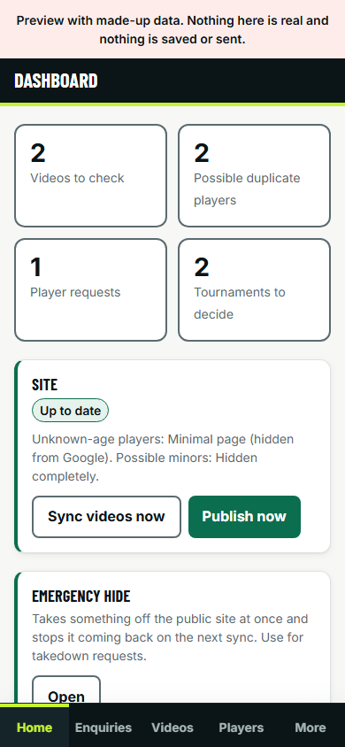

*Admin Home: counts of new enquiries and videos to check, "Sync now", "Publish now" and the Emergency hide button. Today these buttons do nothing real.*

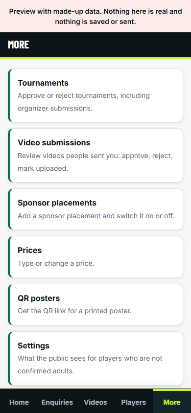

*More: the other areas.*

---

## Your routine (spec section 21, matched to what exists)

### Every upload (NOT LIVE YET until sync is on)
1. Name the video with the **title convention** below (the single biggest time saver).
2. After the next sync (every 6 hours, or press **Sync now**), open **Videos to check** and clear the queue. Most titles in the new convention need no fixing. Budget about five minutes.
3. Paste the usual block into the YouTube description (OT-10). The admin "Description helper" is Phase 2 and does not exist yet. To test the title first, use Title check (below).
4. Share the page on WhatsApp and Instagram, and tag the players, **adults only** (see "What never to do").

### Every tournament you film
1. Print the QR poster (below) and put it up.
2. Ask the organizer to announce the website.
3. Offer a coverage quote for the next edition.
4. Get the organizer's permission to film and publish in writing before you publish the videos (D-019, OT-17). The coverage agreement draft is `docs/legal/coverage-agreement-draft.md`; the lawyer finishes it (OT-15).

### Every day
- Answer new enquiries. Your own working target is the same day or the next. The website does **not** promise customers a time unless you choose one (D-046, question 16 in `docs/OWNER_TODO.md`). Never write "24 hours" on a page by hand.
- Clear follow-ups: in Enquiries each enquiry can carry a follow-up date.

### Every week
- Approve tournaments (More, Tournaments) and review video submissions (More, Video submissions); both below.
- Post upcoming tournaments on the WhatsApp Channel (OT-09).
- Look at the Emergency hide and Player requests lists, even if empty.

### Every month
- Send partner reports (a CSV from the sponsor placement numbers; a branded PDF is Phase 2).
- Update the media-kit figures. They carry an "as of" date and go stale (D-059): re-type them from YouTube Studio (OT-12).
- Review prices (Prices screen). Check zero-result searches for missing players or tournaments (needs analytics, NOT LIVE YET).
- Check the calendar of renewals in `docs/RUNBOOK.md` (domain KYC, key rotation, monitor login).

### Every three months
- Rotate all keys (`docs/SECRETS.md`, "Replacing secrets").
- Pitch new sponsors with the updated media kit and plan events.

### Always
- Label paid promotions (below). Honour removal requests quickly (below).

---

## Answer an enquiry through WhatsApp (NOT LIVE YET)

1. Telegram pings: "New enquiry" with a reference code.
2. Open the admin, **Enquiries**. Each card shows the kind, reference, name, source page and date.
3. Tap **WhatsApp reply**. WhatsApp opens with a prefilled message that carries the reference. The link is built only by the site's one safe helper (D-029), never typed by hand. If the customer has no WhatsApp, tap **Email reply**.
4. Move the status as you go: New, Contacted, Quoted, Won, Completed. **Lost** needs a short reason (three to 500 characters). **Completed** is final (D-091).
5. Add notes and a follow-up date. Notes are for you only. If you type an amount, type rupees: the site stores whole paise and never fills in a price for you (D-091).

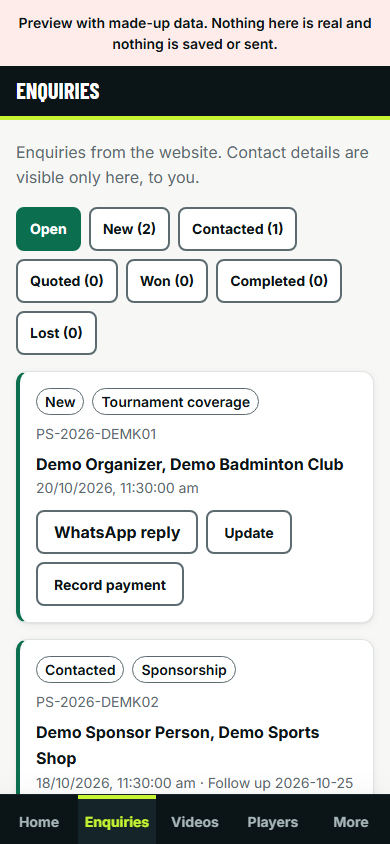

*Made-up enquiries. Each card has WhatsApp reply (or Email reply), Update and Record payment.*

Customers who use the website form are also shown a WhatsApp button on the thank-you screen, so many will message you before you reply.

## Record a payment (NOT LIVE YET: works on made-up data; nothing is saved for real until the real database is connected)

The admin has a **Record payment** button on every enquiry. You type every figure yourself. **The site never fills in an amount, a fee or a tax rate**, and it does not know any of them (D-021, D-091). Ask your accountant (CA) if you are unsure what to type.

1. Take the payment the usual way first: a Razorpay Payment Link made in the Razorpay dashboard and sent on WhatsApp (Razorpay cannot send to WhatsApp itself, D-020), a UPI or bank transfer, or cash. Check the money has really arrived in Razorpay or your bank.
2. Admin, **Enquiries**, find the enquiry, tap **Record payment**. A form opens.
3. **How was it paid?** Choose UPI, bank transfer, Razorpay link or cash. It starts on "Choose..." on purpose.
4. **Payment id or bank reference (UTR).** Copy it from the bank message or the Razorpay payment.
5. **Date the money arrived.** The amount received, in rupees, is the full amount the payment covers, including any tax the payer held back (TDS). Type it yourself, for example `5,000`.
6. **Gateway fee** and **GST on that fee**: for Razorpay payments only, read them from the Razorpay payment page. Type `0` if there is none. If you type a fee, you must also type the GST on it; the form tells you in words if one is missing.
7. **TDS deducted by the payer** and its certificate date, if a sponsor paid you less tax. Leave blank if none.
8. **GST registered?** Choose not set, yes or no. Until it says yes, the only document you can choose is a plain **payment receipt** (an unregistered business does not issue a GST invoice, D-091). An invoice total is optional.
9. Tap **Review the payment**. Missing items appear in plain words ("Type the amount you received.", "Choose how it was paid."). When everything is fine, a **Record this payment?** box shows what you typed: the amount received, the fee, the tax held back and the simple subtractions (what settled to you, and what you receive after tax). Nothing is guessed.
10. Read it, then tap **Record payment** in that box. It is saved with a log entry first, then the enquiry changes status: **a payment makes the enquiry Won**; if you typed an invoice total and this payment settles it, it becomes **Completed**. A lost enquiry must be reopened first. (This rule is the plan's proposal; tell Claude if you want it different.) Tell your CA this rule, and which figures you typed.

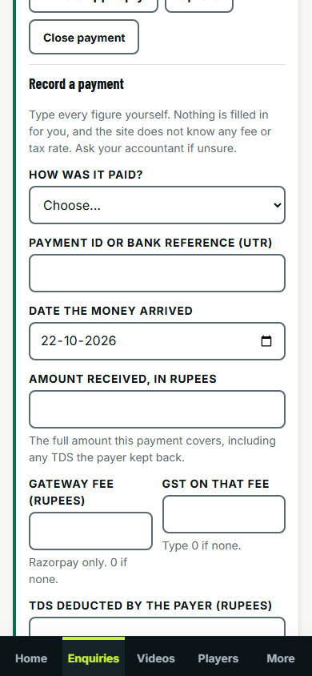

*The form opens empty. Nothing is pre-filled.*

What is **not** there yet: the receipt or invoice itself is not produced (make it the way your CA tells you), GST registration is asked each time instead of being saved, and a recorded payment cannot be edited or reversed in the screen: if you made a mistake, tell Claude. Until a payments table exists in the database, a payment is stored as an entry on that enquiry's history (no phone, name or email in it).

## List a tournament (NOT LIVE YET)

Today a tournament enters one of two ways: you or an organizer fill in **Submit a tournament** (`/tournaments/submit/`), or the sync finds it from video titles. Either way it starts hidden and pending.

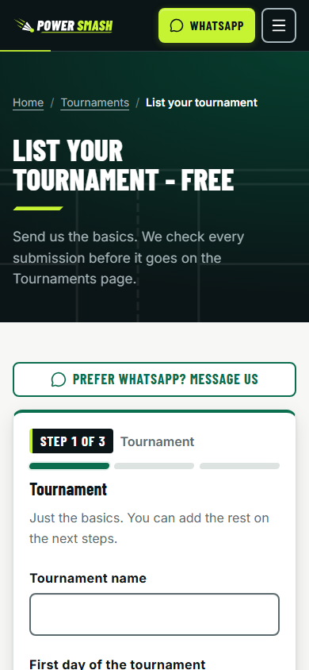

*The public form an organizer fills in.*

To approve: admin, **More**, **Tournaments**, tab **Submitted by organizers**. Tick the three-point checklist before you approve: (1) the organizer is real, (2) the dates and place are right, (3) you have permission to film. Choices are approve, hide, reject. An event outside Tamil Nadu is listed with the video only and gets no player pages (D-018, D-076). Public tournament pages are not built yet, so an approved tournament shows only where the archive mentions it.

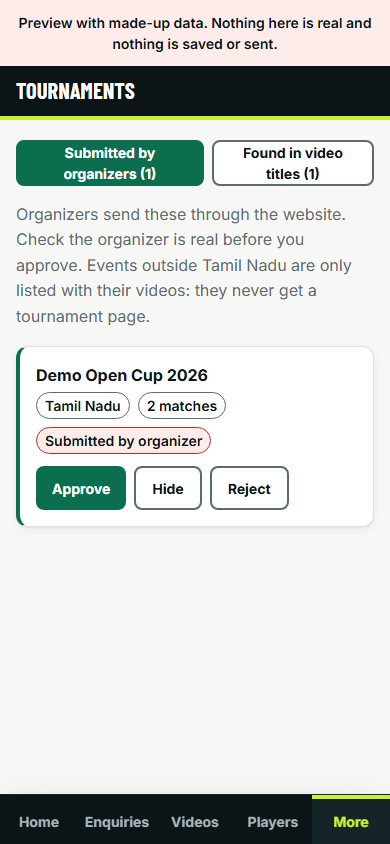

## Print a QR poster (NOT LIVE YET: do not print until the real site address is set)

1. Admin, More, **Posters** (or open `/posters/channel/` for the channel poster, `/posters/<tournament>/` for a tournament).
2. If a red box says "this QR code points at a local address. Do not print it", stop. Printing only becomes safe once `PUBLIC_SITE_URL` is the real address (D-092). Tell Claude.
3. Print from the browser: A4, margins None, headers and footers off. A3 is at the "Open the A3 version" link.
4. Scan the printed poster with your own phone before you put it up.

The QR link carries a campaign tag so you can later see which venue sent visitors.

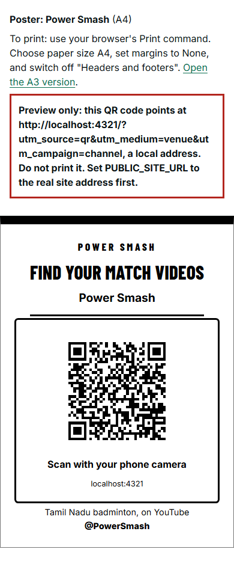

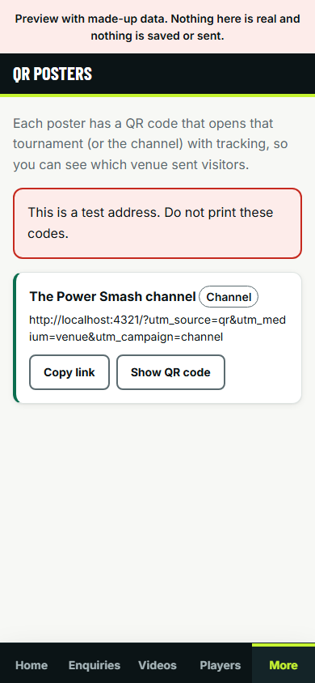

## Approve a submitted video or tournament

**Tournament:** see above.

**Video someone sends you** (`/submit-video/`, NOT LIVE YET: made-up data today). The sender gives a link, confirms rights in four separate boxes (the server refuses a form with an unticked box, D-093) and sees the licence text. You review it in **More, Video submissions**:

1. Each card shows the reference, the link **as plain text** (the site never opens, embeds or loads it), the answers the sender gave (who filmed it, the organizer, whether filming was allowed; a warning if players may be under 18) and **four rights confirmations**, each with the wording version the sender saw. A note appears if the site's wording has since changed, and a missing or unticked box is flagged: **do not approve those**.
2. Tap **Open the link in a new tab** (only plain https addresses are clickable) and watch the video on your own.
3. Tap **Approve** (and confirm), or **Reject**: you must type a reason of 3 to 500 characters ("Say why"). Reject can also be used straight away on a new submission. Reply to the sender on WhatsApp yourself.
4. If you approved it and then uploaded it to YouTube, tap **Mark uploaded with YouTube video id**. It only appears after approval. Type the 11-character id (the last part of the YouTube address, for example the part after `watch?v=`); a pasted whole address is refused with a message that says so.
5. The enquiry in Enquiries follows along: approved is Contacted, uploaded is Completed, rejected is Lost with your reason. Use the tabs on the screen to see Approved, Uploaded and Rejected.

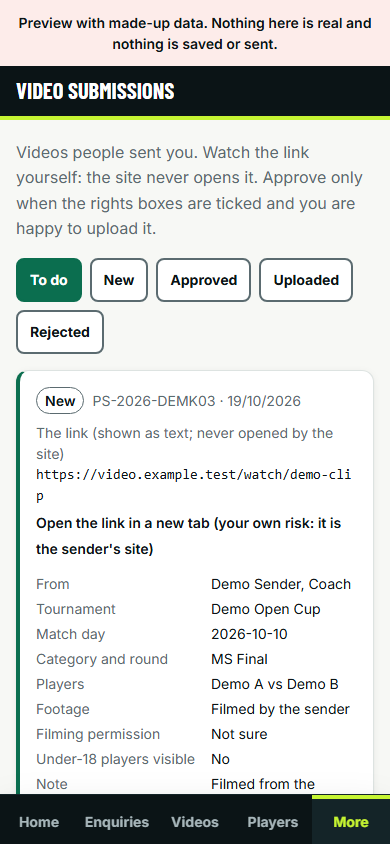

*The review state is kept with the enquiry until a dedicated database table exists. Nothing here is live until the real database is connected.*

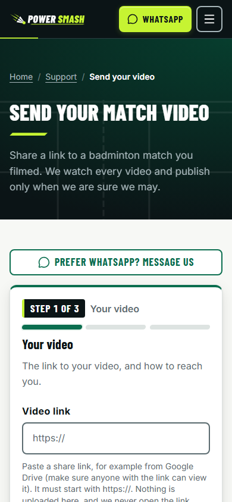

## A removal or parent request (take this seriously; NOT LIVE YET)

People can ask through `/request/` (claim, correct, hide or remove) and the Content Removal page.

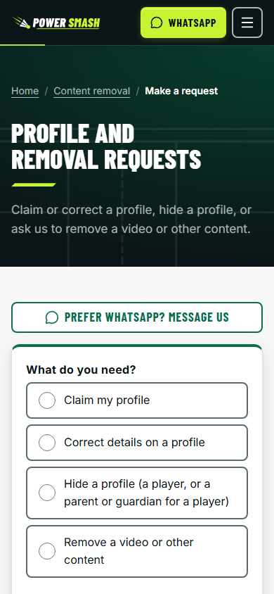

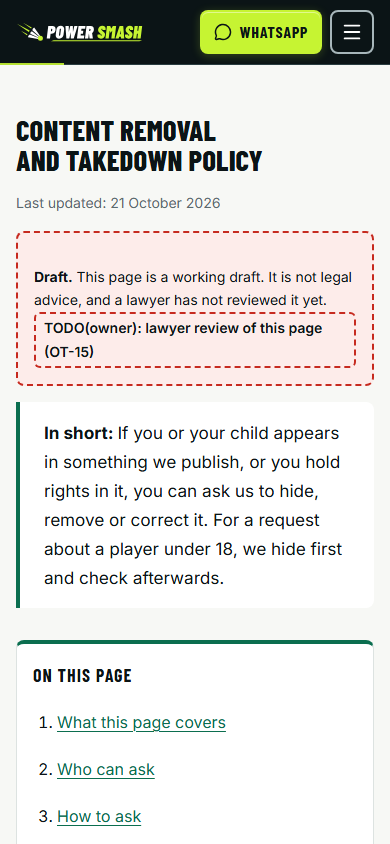

Your targets, taken from D-014 (the lawyer confirms the figures before launch; they are targets, not guarantees, D-062):

| What | Target |
|---|---|
| Acknowledge any removal complaint | within 24 hours |
| Resolve it | within 7 days |
| Parent or guardian asking to hide or remove a child | **within 48 hours** (we hide first, then verify) |
| Court order or a reasoned government notice | **within 3 hours**: your phone must be reachable; your named deputy covers you when away (OT-31) |

Steps:
1. A request arrives as a Telegram alert and in the admin (Players screen, player requests; also Enquiries). Note the time it arrived.
2. If it concerns a child: **hide first**. In the admin Home, use **Emergency hide**. It hides the page, publishes the change, adds the name to the do-not-recreate list so the next sync cannot bring it back, and shows you a four-item checklist: publish now (if it was not done for you), clear the Cloudflare cache for the affected addresses, set the YouTube video to private or unlisted in YouTube Studio, and send a Removals request in Google Search Console (D-014). Then open the old address and check the page is gone.
3. Verify who is asking. A phone call or WhatsApp alone is not the legal standard for a parent (VF-E3); the lawyer decides the proof (OT-28, D-015).
4. Reply to the person. Tell them what was done. Never promise to remove copies on other sites.
5. Write down the times: received, hidden, confirmed gone.
6. Hiding is reversible; ask Claude before you release a hide.

## Title convention v2 for new uploads (D-017)

The site reads your title to find the players, the category and the tournament. New titles in this shape parse cleanly. (Old titles still work; they just need more checking.) Use the same pattern every time. The owner approves this convention (D-017 asks you for a yes).

```
Player A vs Player B || Category Round || Tournament name 2026
```

Rules:
- Use the **double pipe `||`** between the players and the rest.
- A category (MS, WS, MD, WD, XD) and a round (Final, Semi Final, Quarter Final, R16, League...) always appear.
- Players as initial plus surname or full names. Doubles: partners joined by `/`.
- At most one ` - ` and none inside the tournament name; the year goes last.
- Hashtags and emojis are ignored by the parser; put them in the description instead.

Examples (all invented):

| Title you type | What the site understands |
|---|---|
| `Demo Karthik vs Sample Arul || MS Final || Demo District Open 2026` | Men's singles, final, one tournament |
| `Demo Selvi / Mock Kavya vs Sample Divya / Trial Nithya || WD Semi Final || Sample State Championship - Sample City 2026` | Women's doubles, semi final, a city after one dash |
| `Demo Karthik / Mock Bala vs Sample Arul / Trial Ravi || MD Quarter Final || Demo Open 2026` | Men's doubles, quarter final |

(These three were run through the real parser with no warnings and no review flag, on 2026-10-22.)

**Under-18 categories** (U9 to U19, Boys or Girls singles or doubles) make the players "protected" automatically: their names stay in the raw YouTube title, but no profile page exists for them (D-012, D-082). That is correct; do not try to work around it.

**Try a title before you post: Title check** (Videos, tab **Title check**; made-up preview today, the same reading the site uses). Type or paste the title you plan to use. Nothing is saved or sent. It shows the players on each side, category, age group, round, tournament, year, place, how sure it is, and a verdict: **Will auto-accept**, or **Will need review** with the reasons in plain English. It suggests fixes for the convention (double pipe, one dash at most, year last, over 100 characters, hashtags) and gives a corrected title you can copy.

**The age warning.** If anything in the title looks like an age (a bracket such as `(U15)`, a trailing or hashtag age, an age in the tournament name, or a word it cannot place), a red box appears **first**, and the verdict can never read as accepted. It says the players are treated as possibly under 18, the match is held back and, with the launch settings, hidden from the public site. If they are adults, take the age words out of the title; if they are juniors, hiding them is the right result, and you should keep their names out of public posts (spec 15.3, D-012).

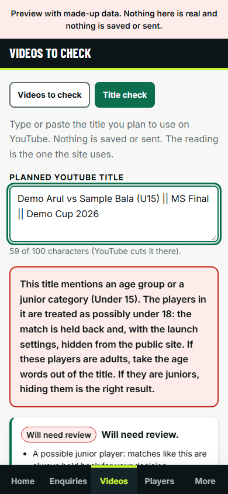

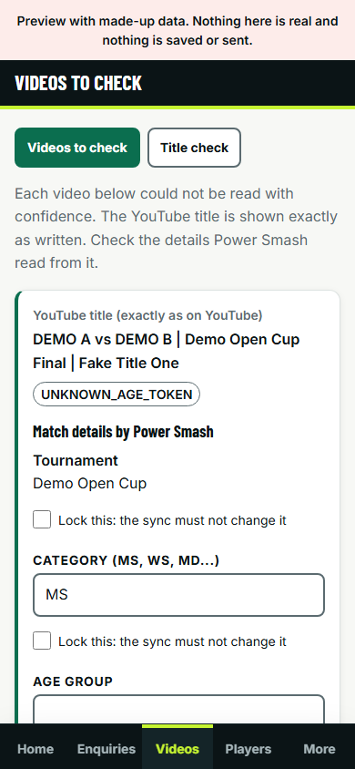

*The queue you clear after each sync. Left: your exact YouTube title. Right: "Match details by Power Smash". You can lock a field you fixed so the next sync does not overwrite it.*

## Players and duplicates

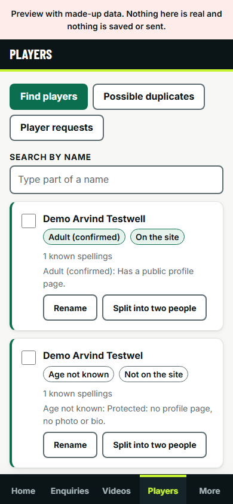

Search, rename, split, merge, "not the same person", and confirm adult. **Never confirm someone as an adult from their own claim** (CLAUDE.md, D-012): a child can say anything. Confirming an adult needs proof you trust; merging a possible minor with a confirmed adult needs a written reason and is logged.

## Sponsors, prices and settings

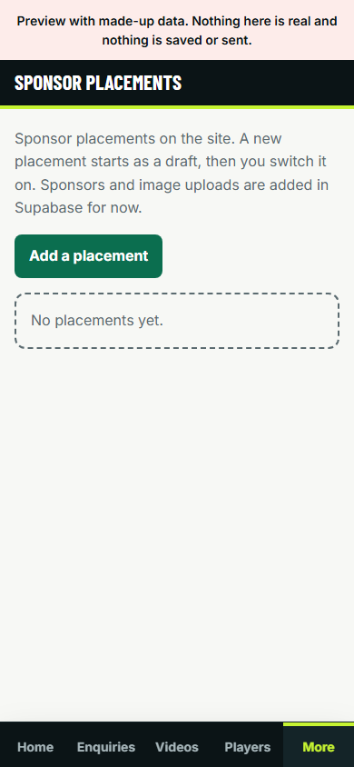

A placement is always created as a **draft**. It needs an image and a link on the sponsor's own website before it can be switched on. "Ended" is final. Banners beside the player stay off until YouTube answers (D-016).

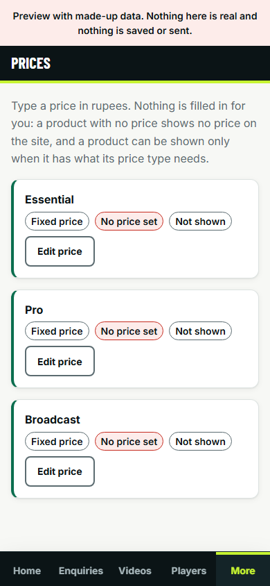

Prices you save are audited and mark the site for rebuild. **Saving prices does not work yet** (the database part is not there; D-091), and no price exists by default.

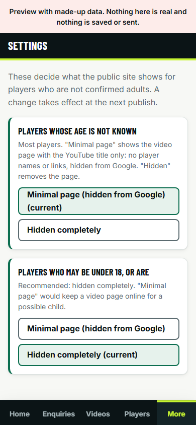

Settings today holds only the two protected-player modes (what to show for unknown-age and for under-18 players: a minimal hidden-from-Google page, or nothing). Changing one is logged and can be undone.

## The public forms, as a visitor sees them

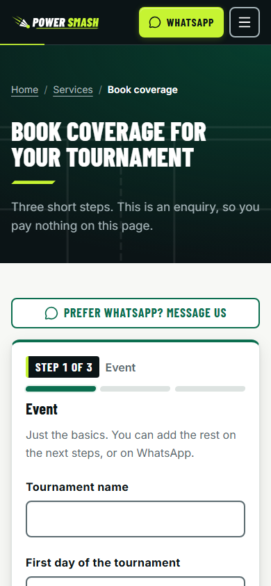

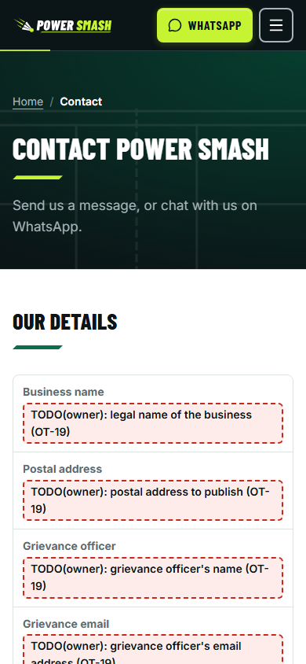

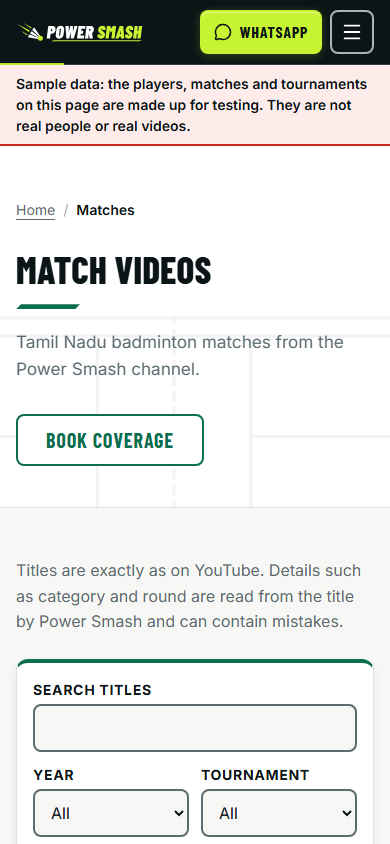

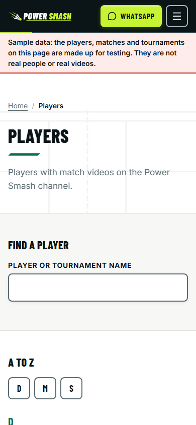

Every form has a notice, unticked consent boxes, a spam check and a WhatsApp fallback if the system is down (D-043). If the form fails, visitors are shown your WhatsApp button; nothing is silently lost.

---

## Label paid promotions: the one-page rules (ASCI and DoCA)

From VERIFIED_FACTS VF-E12 and VF-E13 (read 2026-10-20; the lawyer reviews at OT-15). This is a summary of the rules as we read them, not legal advice.

1. **Disclose every paid or free-gift relationship** (money, free product, a barter, a commission, a partnership). If you got something for it, say so.
2. **Upfront and prominent.** Not only in the bio, not only at the end, not behind "more", not only in hashtags.
3. **Use clear words:** Advertisement, Ad, Sponsored, Collaboration, Partnership, Free gift, Affiliate. Also tick YouTube's **"Includes paid promotion"** setting on the video.
4. **Inside the video itself, spoken and on screen.** Time on screen: at least 3 seconds for a video up to 15 seconds; one third of the length for a video over 15 seconds and under 2 minutes; the whole section where the brand is discussed for videos of 2 minutes or more.
5. **Live streams:** say it at the start and at the end (ASCI), and keep a label on screen for the whole stream, in both audio and picture, in the language of the post (DoCA, 20 January 2023).
6. **Health and nutrition products** (physio, supplements): the person promoting must state relevant qualifications upfront and make no therapeutic claims they are not qualified to make. If a sponsor wants that, say no, or ask the lawyer.
7. **On the website**, every paid slot is labelled "Sponsored" or "Partner" automatically (spec 15.5).
8. **Penalties:** the DoCA know-hows have no fine of their own; fines come under the Consumer Protection Act 2019 section 21 (up to Rs 10 lakh, Rs 50 lakh for a repeat).

Before you post: is anything paid or free? If yes, spoken label + on-screen label + YouTube paid-promotion tick.

---

## Publishing, going back, and changing a setting (Vercel)

NOT LIVE YET: nothing is deployed. This is how it will work (decision D-097). Vercel hosts the site; GitHub builds it and hands it over.

**Publish.** On GitHub (app or website), open `power-smash`, **Actions**, **Deploy**, **Run workflow**. It runs the strict checks first; if any page still has a gap, a private detail or a missing setting, it stops and nothing changes on the live site. A green tick means the new version is live. Claude tells you before each real publish and waits for your yes.

**Look before you publish.** Use the private preview (`docs/PREVIEW.md`): it opens only after you log in to Vercel and uses made-up data.

**Go back to the last good version.** If the new version looks wrong: in the Vercel app or website open the `power-smash` project, **Deployments**, choose the last good production one, then use **Instant Rollback** (or **Promote to Production**). I have not verified those buttons and their plan limits on a real account, so if you do not see them, tell me and I will revert the change on GitHub and publish again (slower, always works). Going back changes the site only; it does not undo your database.

**Change a setting.** In Vercel, project **Settings**, **Environment Variables**: pick **Production** (the live site) or **Preview** (tests), edit, save. **A saved change only reaches the site after the next publish**, so run **Deploy** again (or ask me). Never put a test key under Production.

**The bill.** The live site needs Vercel **Pro** (USD 20 a month per seat, from Vercel's pricing page). You buy it yourself in Vercel; I never enter a card. Hobby (free) is for private previews only: Vercel's terms do not allow a business site on it.

---

## What you must never do

1. **Never paste a password, key, token or code into chat, a screenshot, an email or a video** (CLAUDE.md, D-027). You type secrets yourself, directly on the provider's screen, or run the loader on your PC. If you pasted one by accident, say so straight away and follow "If a secret leaks" in `docs/SECRETS.md`.
2. **Never tag, or promote through, a junior player's own account.** No marketing to minors (spec 15.3; D-012). Share the match page and tag adults and organizers. If a parent contacts you, reply to the parent.
3. Never confirm a player as an adult from their own say-so.
4. Never write a price, fee, tax rate, discount or reply time on a page that you have not chosen; never type the gap marker `TODO(owner)` into a page.
5. Never switch on `TELEGRAM_ALERT_PHONE_LINK` (it puts the customer's phone number into Telegram) without both your own clear yes and the lawyer's updated privacy page (D-045).
6. Never share the private preview link with anyone, and never switch off Vercel's login on previews (OT-47, `docs/PREVIEW.md`).
7. Never turn on the sync, backup, email or publish switches yourself until Claude names them (`docs/SECRETS.md`; the full list is in `docs/RUNBOOK.md`).
8. Never make the code repository public (private repo, D-073).
9. Never use a real player's name or the real WhatsApp number in test data.
10. Never publish an organizer's contact details, and never film or publish without permission (D-019).

## When something looks wrong

| You see | Do this |
|---|---|
| Telegram says "no sync for 8 hours" | Admin Home, **Sync now**. If it stays red, tell Claude. Nothing is lost; the site simply shows older videos (D-008). |
| A form shows "could not send" | The visitor still sees your WhatsApp button (D-043). Open the site yourself, try once, tell Claude the time. |
| The uptime monitor messages you | Open the two addresses it watches, see `docs/UPTIME_RUNBOOK_DRAFT.md` and `docs/RUNBOOK.md`, tell Claude. |
| A player says "that is my child" or "remove me" | Removal steps above, now. |
| A page shows a name it should not | **Emergency hide**, then tell Claude. |
| You cannot sign in to the admin | Do not retry many times. See "MFA reset" in `docs/RUNBOOK.md`; tell Claude. |
| You think someone else saw a key, a password or a customer list | Revoke at the provider first, then tell Claude (`docs/SECRETS.md`). India's cyber incident rule gives 6 hours to report; Claude and the lawyer handle that with you. |
| A "Sample data" banner or a gap marker appears on the real site | Tell Claude. The strict publish should have stopped it. |
| A screen looks different from this guide | Send Claude a screenshot (never one that shows a password or code). |

---

## Screenshot index

These files are in `docs/guide/` and are regenerated with `node scripts/with-lock.mjs heavy -- node scripts/guide-shots.mjs` after a build.

| File | Shows |
|---|---|
| `admin-dashboard.png` | Admin Home |
| `admin-enquiries.png` | Enquiries |
| `admin-videos.png` | Videos to check |
| `admin-players.png` | Players |
| `admin-tournaments.png` | Tournaments |
| `admin-sponsors.png` | Sponsor placements |
| `admin-prices.png` | Prices |
| `admin-posters.png` | QR posters |
| `admin-settings.png` | Settings |
| `admin-more.png` | More menu |
| `admin-submissions.png` | Video submissions |
| `admin-record-payment.png` | Record payment form |
| `admin-title-check.png` | Title check with age warning |
| `poster-channel.png` | Channel poster page |
| `form-book.png` | Book form |
| `form-contact.png` | Contact form |
| `form-request.png` | Profile and removal request |
| `form-submit-video.png` | Send your video |
| `form-tournament-submit.png` | Submit a tournament |
| `page-content-removal.png` | Content removal page |
| `archive-matches.png` | Matches list |
| `archive-players.png` | Players list |

## Where to read more

`docs/OWNER_TODO.md` (what you do next, in order), `docs/SECRETS.md` (where each secret goes), `docs/RUNBOOK.md` (what Claude or a technical helper does when something breaks), `docs/DECISIONS.md` (why each choice was made), `docs/legal/` (what the lawyer reviews).
